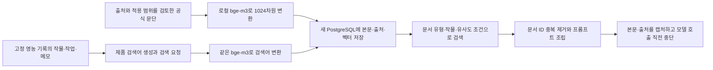

# 공식 문서로 실제 검색 경로 재현하기

## 목적과 경계

앞 단계는 사용자의 입력이 PostgreSQL 저장·조회 후 AI 입력으로 정확하게 바뀌는지 확인했다. 이번 단계는 **어떤 공식 문서가 실제 검색되고 그 본문이 답변 모델 직전까지 전달되는지** 확인한다. 검색용 임베딩은 실제 `bge-m3`를 로컬에서 실행한다. 답변을 작성하는 모델은 호출하지 않는다. 의료 효능, 농약 사용 적합성, 실제 코칭 답변의 정확성 검증은 포함하지 않는다.

제품 API·프롬프트·검색 코드·DB 계약은 변경하지 않았다. 테스트에서 실제 `RecordFeedbackGenerationService`와 Spring AI 1.1.8 `PgVectorStore`를 조합한다. 전체 앱을 띄우지 않으므로 인증·날씨·메일·비동기 실행·외부 chat 설정은 사용하지 않는다. 기록→DB→AI 입력 검증과 이번 검색 검증은 각각 수행했으며, 하나의 HTTP 요청으로 연결한 종단 간 검증은 후속 단계다.

## 왜 이 자료인가

과거 팀원이 사용한 PDF 5개와 580개 TECH_DOCUMENT 벡터의 실제 파일·DB는 확보되지 않았다. 따라서 당시 환경 복원이나 당시 성능 재현으로 표현하지 않는다. 지금 확보 가능한 농촌진흥청 공식 자료 2개로 같은 검색 기술과 제품 검색 경로를 재현한다.

| 공식 자료 | 발행 | 이번에 선택한 재배 내용 | 직접 답할 수 없는 것 |
|---|---|---|---|
| [천궁·당귀 재배 전에 안전 재배지인지 확인하세요](https://www.rda.go.kr/board/board.do?dataNo=100000732652&mode=view&prgId=day_farmprmninfoEntry) | 2017-03-23 | 고온 취약성, 재배 가능지·적합지의 위험과 물 관리 | 현재 기후, 실제 농장 적지 판정, 농약 처방 |
| [고온 취약한 약용작물, 재배 관리 필수](https://www.rda.go.kr/board/board.do?dataNo=100000802838&mode=view&prgId=day_farmprmninfoEntry) | 2025-05-27 | 고온·수분 스트레스, 물·영양 관리, 병든 식물 제거와 증상 확인 | 특정 제품·희석 배수·시비량·현재 시장 가격 |

두 문서가 모두 천궁을 명시하므로 평가 작물은 **천궁**이다. 문서의 ‘당귀’를 작물 목록의 ‘참당귀’와 동일하다고 가정하지 않았다. 여러 작물을 포함하는 문서라 `cropName=GENERAL`을 사용했다. GENERAL은 필터에서 여러 작물에 허용된다는 의미이며 모든 작물에 내용이 적합하다는 보증은 아니다.

작업별 지원 범위는 관수와 재배 환경·고온 관리에 직접 근거가 있고, 비료·병해충·제초는 일반 관리 문장만 있다. 심기 방법·수확 적기·가지 정리의 구체적 지침은 없다. 8개 작업 유형의 코칭 품질이나 534개 작물 전체로 확대 해석하지 않는다.

## 왜 이 순서로 확인하는가

초보 농업인은 기록 후 자신의 상황에서 다음에 무엇을 할지 판단하기 어렵다. 메모에는 ‘질소를 많이 줌’, ‘병든 식물이 있음’ 같은 상황이 들어간다. 그래서 작물명과 작업 유형에 메모를 더해 근거 문서를 찾는 설계를 검증한다. 문서가 실제로 저장됐는지, 검색 조건을 통과했는지, 모델 입력에도 그대로 들어갔는지를 따로 확인해야 어느 단계의 문제인지 설명할 수 있다.

`bge-m3`는 이미 학습된 임베딩 모델이다. 이번에는 문서와 검색어를 숫자 벡터로 변환하고 DB에서 가까운 벡터를 찾는다. 이 과정을 **문서 적재·인덱싱·검색**이라고 표현한다. 모델 가중치를 추가 학습하거나 파인튜닝하는 과정은 포함하지 않는다.



## 원문과 조각

`prepare-rag-corpus.py`는 두 URL에서 원문 HTML을 보존하고 검토한 문단의 시작 문자열로 본문을 선택한다. 문단을 찾지 못하거나 둘 이상이면 실패한다. 원문 전체, 선택 문단, SHA-256, 가져온 시각, 출처를 `/private/tmp/chamchamcham-rag-retrieval/`에 남긴다. 원문 캐시가 있으면 재사용하므로 비교 중 새 기사 내용으로 바뀌지 않는다. 새로 확보하려면 별도의 출력 폴더에서 준비한 후 내용을 재검토해야 한다.

선택 문단 외의 사이트 메뉴·연락처·인체 효능 각주·당시 전망 및 웹서비스 현황은 검색 본문에서 제외한다. 원문은 손대지 않는다. 2017년/2025년 기사를 현재 날씨로 사용하지 않는다. 웹 문서라 페이지 번호는 만들지 않는다. 출처 표시를 유지하고 원문·모델·DB는 Git에 넣지 않는다.

문단 경계를 유지하며 최대 1,200자, 이어지는 조각에는 이전 조각 끝 160자를 겹치게 한다. 이번 본문은 각각 490자·748자로 **총 2개 조각**이라 실제 겹침은 발생하지 않았다. ID는 URL·선택 본문 해시·조각 번호로 결정한다. 같은 자료를 두 번 넣어도 개수가 늘지 않는지 DB에서 확인한다.

## 다시 실행하기

준비: Docker 실행, Java 21, 프로젝트 Gradle 의존성 캐시, Python 3. 인터넷은 최초 공식 문서·Ollama 이미지·bge-m3 다운로드에 필요하다. 임베딩과 DB 처리는 로컬이다. 설치된 호스트 Ollama는 사용하지 않는다.

```bash
# 저장소 루트에서 실행한다.
docker pull pgvector/pgvector:0.8.5-pg16
docker pull ollama/ollama:latest
python3 scripts/test-prepare-rag-corpus.py
python3 scripts/test-verify-rag-local.py
python3 scripts/verify-rag-local.py
./gradlew test --offline --console=plain
```

runner는 이미지 태그를 실제 ID로 고정하고, 실행 전후 모델 digest가 같은지 확인한다. 후일 모델/이미지 태그가 다른 버전을 가리키면 같은 재현 환경으로 간주하지 말고 `infrastructure.json`을 비교한다. Ollama 모델 캐시 전용 볼륨 `ccc-rag-bge-m3-cache`는 반복 다운로드를 줄이기 위해 남긴다. 기존 컨테이너·볼륨은 시작·변경·삭제하지 않는다.

각 실행은 무작위 이름의 컨테이너 2개를 만들며 DB는 새 tmpfs다. 둘 다 `127.0.0.1`의 임의 포트에만 노출한다. 종료 시 이 실행이 만든 컨테이너만 제거한다. 검증 프로세스는 30분 제한이며 초과하면 해당 프로세스 그룹을 종료하고 컨테이너를 정리한다. 검증 DB 이름·주소·일회용 guard token을 확인한 뒤 스키마를 생성한다. 비밀값은 Git/결과에 남기지 않는다. 실행 중 강제 종료되면 `ccc-rag-` 이름과 verification label을 확인해 그 실행의 컨테이너만 정리한다.

테스트는 `RUN_LOCAL_RETRIEVAL_VERIFY=true`일 때만 실행한다. runner가 주소·비밀번호·guard를 전달하므로 평소 `./gradlew test`에는 실제 모델 호출이 없다. 독립 PostgreSQL의 vector(1024), 코사인 거리, HNSW 인덱스를 사용한다. 임베딩은 조각별 순차 처리하고 입력 자동 자르기는 비활성화한다.

## 평가와 결과 읽기

8개 상황의 기대 근거는 검색 실행 전에 `rag-retrieval-cases.json`에 적었다. 3개 환경·수분 상황, 2개 구체적 메모, 1개 메모 120자 뒤 핵심, 2개 자료 범위 밖 상황이다. 모두 동일한 천궁 관수 기록의 메모를 달리한다. 시각·기록 당시 날씨는 고정하며 실시간 날씨는 null로 두어 날씨 검색 변수를 제거했다. 비료·농약 저장 API를 검증하는 사례가 아니다.

각 상황은 기본 검색만/메모 검색 추가, 임계값 0/.5/.55로 6회씩 총 48번 비교한다. 기본 검색만 조건은 테스트에서 planner의 첫 검색어만 남긴 대조군이다. 제품 검색 구현을 복제하지 않는다. 검색당 topK=3이다. 0은 임계값 제외 효과를 비교하기 위한 조건이며 코사인 유사도 음수까지 무조건 반환한다는 뜻은 아니다.

테스트는 실제 요청의 임계값·topK와 실제 반환 점수를 확인하고, 같은 본문을 가진 다른 작물·FARMING_RECORD 검증용 조각이 섞이지 않는지 확인한다. 여러 검색 결과가 같은 ID면 최종 근거에 한 번만 들어가는지도 확인한다. 프롬프트 본문·ID·전체 메모 보존을 비교한다. 임계값 1의 별도 조건에서는 검색 근거가 없어 `INSUFFICIENT_EVIDENCE`가 발생하고 chat에 도달하지 않는지 확인한다.

`CAPTURED_BEFORE_CHAT`은 검색·프롬프트 조립 후 테스트가 답변 모델 호출 직전 중단했다는 뜻이다. 제품은 이 중단을 `CHAT_UNAVAILABLE`로 변환한다. 실제 외부 chat 장애나 코칭 생성 성공을 뜻하지 않는다. `INSUFFICIENT_EVIDENCE`는 필터·점수 기준을 통과한 문서가 없다는 뜻이다. **문서가 반환됐다는 사실은 질문에 답할 근거가 있다는 뜻이 아니다.** 자료 밖 질문도 관련 있어 보이는 일반 문서를 받을 수 있으므로 사람이 원문과 대조해야 한다.

결과는 `api/build/rag-local-verification/`의 `comparisons.json`(검색어·점수·문서·프롬프트), `database.json`(DB 재조회), `infrastructure.json`(이미지·모델 digest), `gradle.log`에 남는다. 원문·선택 본문·manifest·chunks는 위 임시 폴더에 남는다. Git에는 요약 결과와 재실행 도구만 보관한다.
